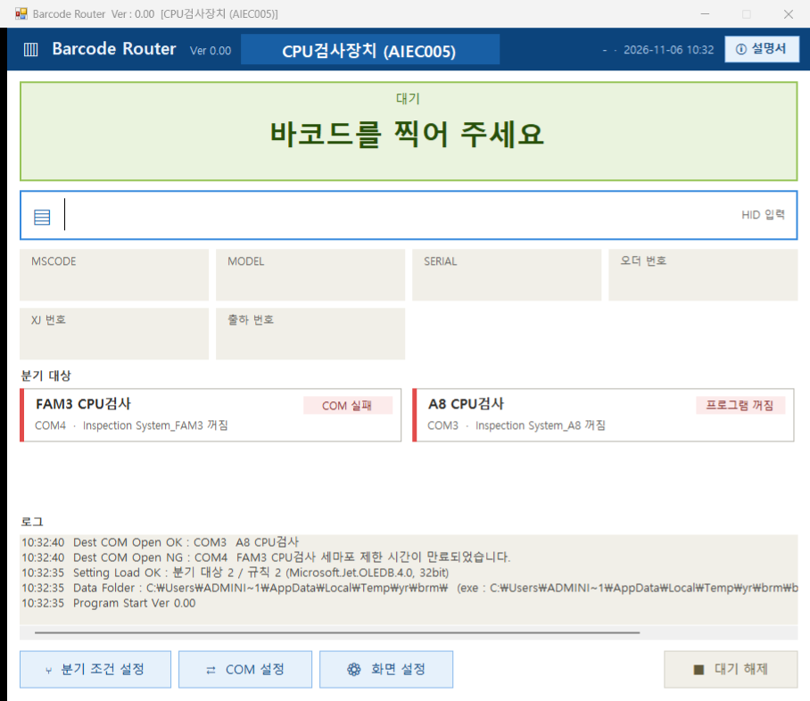
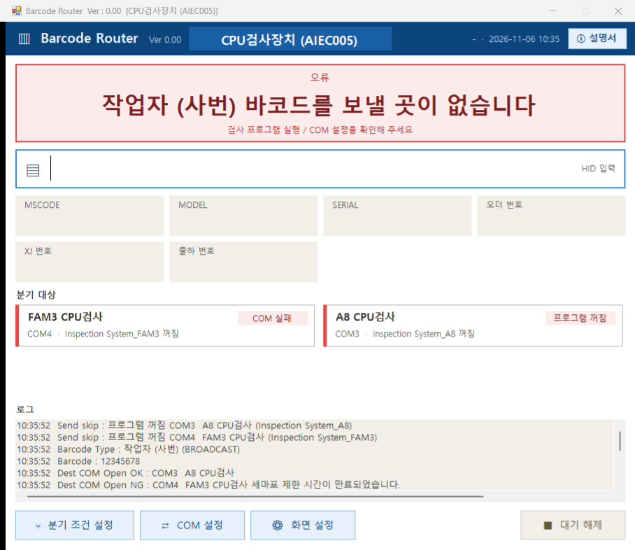
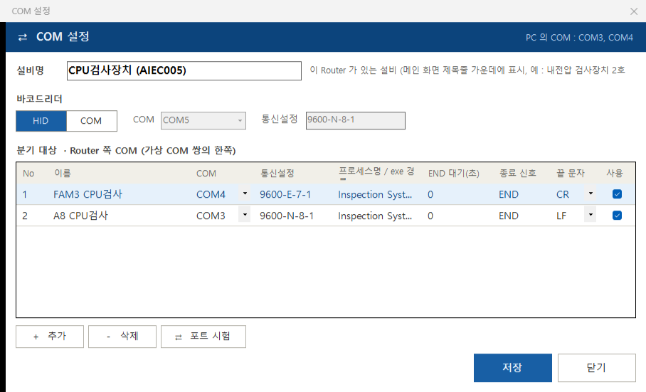
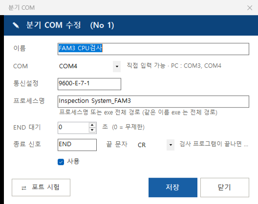
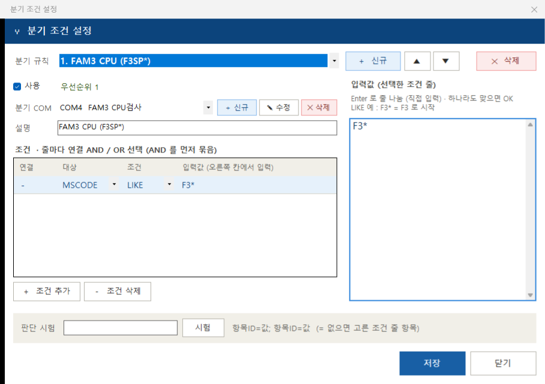
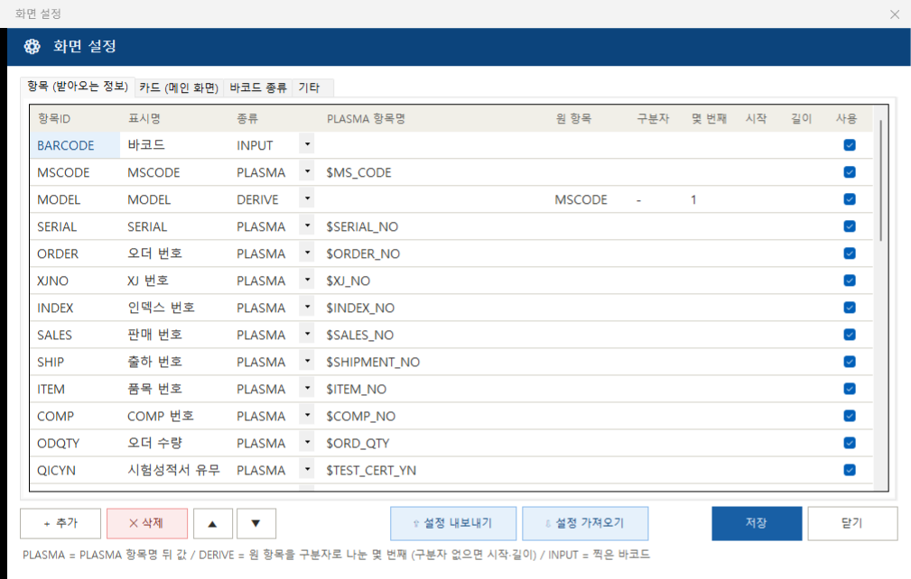
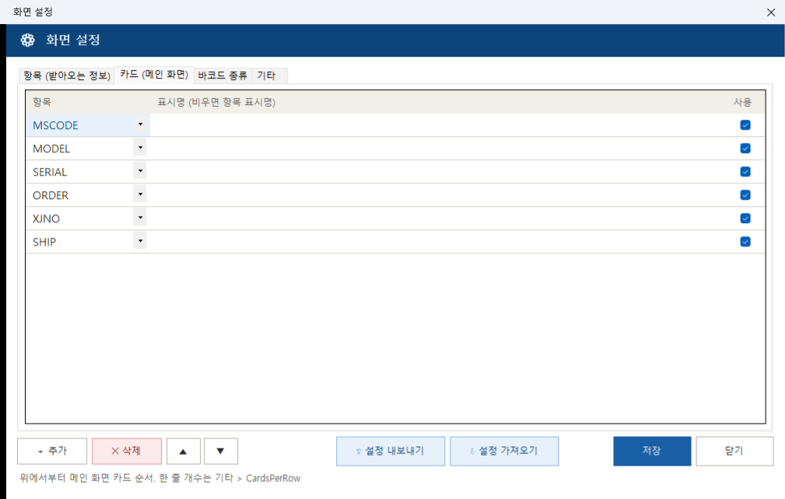
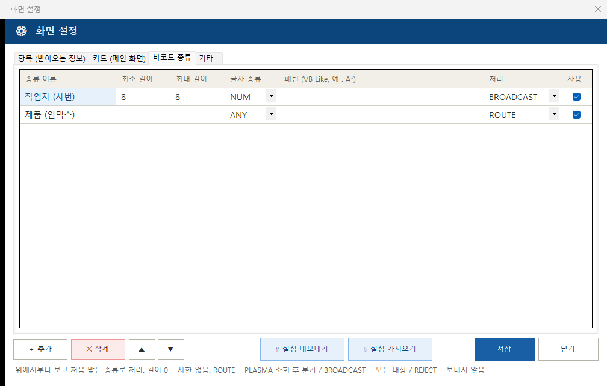
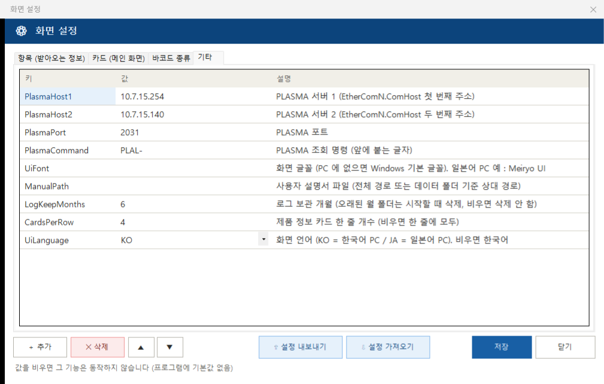
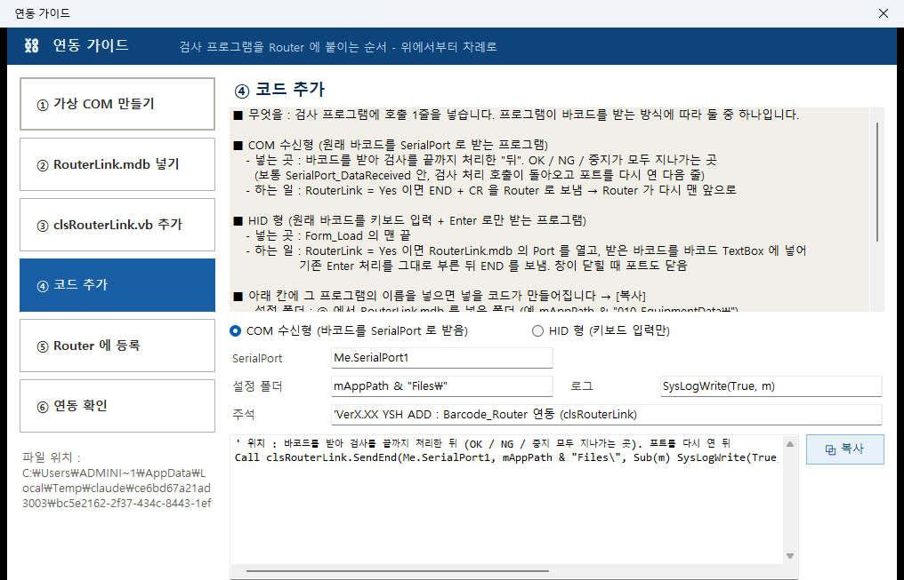

# Barcode Router 사용설명서

| 항목 | 내용 |
|---|---|
| 대상 프로그램 | Barcode_Router Ver 0.00 |
| 문서 개정 | Rev 0 (2026-11-06) 최초 작성 / Rev 1 (2026-11-13) 연동 가이드, RouterLink.mdb 방식 (7장) |
| 원본 | 이 파일(Markdown)이 원본이고, 같은 폴더의 `IM_Barcode_Router.docx`(Word 판)와 `IM_Barcode_Router.pdf`(PDF 판, 목차·책갈피 클릭 이동)는 이 파일로 만듭니다 (`tools\README.txt`). |
| 화면 예 | 화면 그림은 CPU검사장치(A8 + FAM3) 설정 예로 찍었습니다. 설비마다 이름, COM 번호, 규칙은 다릅니다. |

---

## 1. 개요

### 1.1 Barcode Router 란

한 대의 PC에서 검사 프로그램 여러 개를 동시에 켜 두고, **바코드 리더 하나로** 제품에 맞는 검사 프로그램을 자동으로 고르게 해 주는 프로그램입니다.

- 작업자가 Router 화면에서 바코드를 찍습니다.
- Router가 PLASMA에서 제품 정보를 조회하고, **분기 조건**(예: MSCODE가 `F3*` 이면 FAM3)에 따라 보낼 검사 프로그램을 정합니다.
- 정한 검사 프로그램으로 바코드를 **가상 COM**으로 보내고, 그 프로그램 창을 맨 앞으로 띄웁니다.
- 검사 프로그램이 검사를 끝내고 `END` 를 회신하면, Router 창이 다시 맨 앞으로 와서 다음 바코드를 기다립니다.

### 1.2 구성

| 구성 | 연결 | 하는 일 |
|---|---|---|
| 바코드 리더 | HID(키보드 입력) 또는 COM → Router | 바코드 입력 |
| Barcode Router | PLASMA 서버 (네트워크) | 제품 정보 조회, 분기 조건 판단 |
| 가상 COM 짝 1 (com0com) | Router 쪽 COM8 ⇄ COM9 검사 프로그램 쪽 | Router → A8 검사 프로그램 : 바코드 / A8 → Router : END |
| 가상 COM 짝 2 (com0com) | Router 쪽 COM11 ⇄ COM12 검사 프로그램 쪽 | Router → FAM3 검사 프로그램 : 바코드 / FAM3 → Router : END |
| 검사 프로그램 (A8, FAM3 …) | 각자 짝의 검사 프로그램 쪽 COM | 바코드를 받아 검사, 끝나면 END 회신 → Router 가 다시 맨 앞으로 |

(COM 번호는 CPU검사장치 예입니다)

- **가상 COM 짝**: com0com 으로 만든 두 COM 포트는 케이블로 이어진 것처럼 동작합니다. Router 가 COM8 에 쓰면 검사 프로그램이 COM9 에서 받고, 검사 프로그램이 COM9 로 `END` 를 보내면 Router 가 COM8 에서 받습니다 (3장).
- **검사 프로그램 쪽 변경**은 "Router 사용 / 미사용" 설정 1칸과 `END` 회신 1줄뿐입니다 (7장).
- 검사 프로그램은 Router 없이도 원래대로 쓸 수 있습니다 (7.6).

### 1.3 동작 순서 (제품 바코드)

| 순서 | Router 동작 | 화면 |
|---|---|---|
| 1 | 바코드 수신 → **바코드 종류** 판단 (화면 설정 > 바코드 종류) | |
| 2 | PLASMA 조회 → 항목 값(MSCODE, MODEL 등) 만들기 | 상태 "PLASMA 조회 중" |
| 3 | 제품 정보 **카드** 표시 | 카드에 값 표시 |
| 4 | **분기 규칙**을 우선순위 순으로 보고 처음 맞는 규칙의 분기 대상 결정 | |
| 5 | 분기 대상 프로그램이 켜져 있는지 확인 (프로세스명) | 꺼져 있으면 빨간 오류 |
| 6 | 분기 대상 COM 으로 바코드 + 끝 문자 전송 | 상태 "검사 중", 바코드 칸 잠금 |
| 7 | 검사 프로그램 창을 맨 앞으로 | 검사 프로그램 화면 |
| 8 | `END` 수신 | Router 창이 맨 앞으로, 상태 "대기" |

---

## 2. 설치와 실행

### 2.1 필요 환경

| 항목 | 내용 |
|---|---|
| OS | Windows 10 / 11 |
| .NET | .NET Framework 4.8 |
| MDB 엔진 | Router 는 32bit 프로그램입니다. Windows 기본 Jet 4.0 으로 설정 파일(.mdb)을 읽으므로 따로 설치할 것이 없습니다. (Jet 이 없으면 ACE 12.0 → ACE 16.0 순서로 찾습니다) |
| 가상 COM | com0com (3장) |
| 네트워크 | PLASMA 서버에 접속할 수 있어야 합니다 (제품 바코드 조회) |

### 2.2 폴더 구성

설비 PC 에는 Git 저장소를 `C:\Barcode_Router` 에 받는 것을 기준으로 합니다.

| 경로 | 내용 |
|---|---|
| `C:\Barcode_Router\` | 저장소 |
| `C:\Barcode_Router\Barcode_Router\` | 데이터 폴더 |
| `…\Barcode_Router\bin\Release\Barcode_Router.exe` | 실행 파일 (빌드 결과) |
| `…\Barcode_Router\Files\RouterSetting.mdb` | 설정 파일 (분기 규칙, COM, 화면 설정 모두) |
| `…\Barcode_Router\Files\Backup\` | 설정 가져오기 때 이전 설정 보관 |
| `…\Barcode_Router\System_Log\yyyy-MM\yyyy-MM-dd.txt` | 로그 |
| `…\Barcode_Router\Manual\` | 이 설명서 (md, docx, 그림) |

**설정 파일을 찾는 순서**

| 순서 | 조건 | 사용하는 데이터 폴더 |
|---|---|---|
| 1 | 실행 인수 `/data:폴더` 가 있음 | 그 폴더 |
| 2 | exe 경로에 `\bin` 이 있고, 그 한 단계 위에 `Files\RouterSetting.mdb` 가 있음 | bin 의 한 단계 위 (예: `C:\Barcode_Router\Barcode_Router\`) |
| 3 | 그 밖 (exe 를 다른 곳에 복사) | `C:\Barcode_Router\Barcode_Router\` |

- 시작할 때 로그 첫 부분에 `Data Folder : …` 로 실제로 쓰는 폴더가 남습니다.
- 설정 파일이 없으면 "설정을 읽지 못했습니다" 안내 후 빈 설정으로 켜집니다. 이 상태에서는 바코드를 보내지 않습니다.
- 저장소의 `Files\RouterSetting.mdb` 는 설비 설정입니다. 설비마다 내용이 다르므로 **설비 PC 에서 바꾼 설정 파일은 커밋하지 않습니다.**

### 2.3 실행

1. `bin\Release\Barcode_Router.exe` 를 실행합니다. 바탕화면에는 이 exe 의 **바로가기**를 두는 것을 권장합니다.
2. Router 는 **한 번에 하나만** 실행됩니다. 이미 켜져 있으면 새로 켜지지 않습니다.
3. 검사 프로그램(A8, FAM3 등)도 함께 실행해 둡니다. 순서는 상관없습니다.

---

## 3. 가상 COM (com0com) 설치

Router 와 검사 프로그램을 잇는 가상 COM 짝을 만듭니다. 관리자 권한이 필요합니다.

### 3.1 준비

1. 관리자 권한 계정 (드라이버 설치). 회사 보안 정책으로 막히면 IT 담당 승인을 받습니다.
2. **com0com 서명판 64bit** : `com0com-2.2.2.0-x64-fre-signed.zip` (SourceForge com0com 프로젝트)
   - 서명이 없는 판은 Windows 10 / 11 64bit 에서 드라이버가 올라가지 않습니다.
3. 지금 쓰고 있는 COM 번호 확인 : 장치 관리자 > 포트(COM & LPT). 특히 실제 바코드 리더의 COM 번호를 적어 둡니다.

### 3.2 설치

1. zip 을 풀고 `setup.exe` 를 마우스 오른쪽 > **관리자 권한으로 실행** 합니다.
2. 구성 요소, 설치 위치는 기본값 그대로 설치합니다.
3. "드라이버를 설치하시겠습니까" 창이 뜨면 **설치** 를 누릅니다.
4. 설치가 끝나면 기본 짝 `CNCA0 ↔ CNCB0` 이 하나 만들어집니다 (3.3 에서 지웁니다).

### 3.3 COM 짝 만들기

1. 시작 > `cmd` > 마우스 오른쪽 > 관리자 권한으로 실행
2. 설치 폴더로 이동 (둘 중 있는 쪽)

```
cd "C:\Program Files (x86)\com0com"
cd "C:\Program Files\com0com"
```

3. 짝 만들기 (CPU검사장치 예 : A8 = COM8 ⇄ COM9, FAM3 = COM11 ⇄ COM12)

```
setupc install PortName=COM8 PortName=COM9
setupc install PortName=COM11 PortName=COM12
```

4. 확인 후 기본 짝 지우기 (`setupc list` 에서 CNCA0 / CNCB0 줄 앞 번호, 보통 0)

```
setupc list
setupc remove 0
setupc list
```

- 판정 : `setupc list` 에 만든 포트 4개가 보이고 CNCA0 / CNCB0 은 없음
- 명령 대신 화면으로 해도 됩니다 : 시작 메뉴 com0com > Setup → Add Pair → 이름을 COM8 / COM9 로 바꾸고 Apply
- "COM8 is in use" 같은 경고가 나오면 그 번호는 이미 쓰는 중입니다. 다른 번호로 만들고, 5장 / 7장의 설정 값도 그 번호로 바꿉니다.

### 3.4 확인

- 장치 관리자 > "com0com - serial port emulators" 아래에 만든 포트가 모두 있고 노란 느낌표가 없으면 정상입니다.
- 노란 느낌표가 있으면 드라이버가 올라가지 않은 것입니다 (보안 부팅 등). 속성 > 장치 상태 문구를 적어 담당자에게 알립니다.

### 3.5 설비별 짝 (예)

| 설비 | 대상 프로그램 | Router 쪽 | 검사 프로그램 쪽 | 통신 설정 |
|---|---|---|---|---|
| CPU검사장치 (AIEC005) | A8 CPU검사 | COM8 | COM9 | 9600-N-8-1 |
| CPU검사장치 (AIEC005) | FAM3 CPU검사 | COM11 | COM12 | 9600-E-7-1 |
| 내전압 검사장치 | A8 내전압 | COM8 | 설비에서 확정 (예 : COM9) | 9600-N-8-1 |
| 내전압 검사장치 | FAM3 메인 내전압 | COM11 | 설비에서 확정 (예 : COM12) | 9600-N-8-1 |

- Router 쪽 번호는 **Router 의 분기 대상 COM** (5.2), 검사 프로그램 쪽 번호는 **검사 프로그램의 BarcodeReaderPort** (7.2) 에 넣습니다.
- 짝의 두 포트는 통신 설정(속도, 패리티 등)을 같게 넣습니다.

### 3.6 가상 COM 지우기

1. 관리자 cmd → 설치 폴더 → `setupc list` 로 번호 확인 → `setupc remove 번호` (짝마다)
2. 또는 제어판 > 프로그램 제거 > com0com

---

## 4. 메인 화면과 조작



### 4.1 화면 구성

| 위치 | 이름 | 내용 |
|---|---|---|
| 맨 위 왼쪽 | 프로그램 이름 / 버전 | Barcode Router Ver 0.00 |
| 맨 위 가운데 | 설비명 | COM 설정 > 설비명 |
| 맨 위 오른쪽 | 작업자 · 날짜 시각 | 마지막으로 보낸 작업자 바코드 (바코드 종류명 + 값). 없으면 `-` |
| 맨 위 오른쪽 | ⓘ 설명서 | 화면 설정 > 기타 > ManualPath 의 파일(이 설명서)을 엽니다 |
| 상단 큰 칸 | 상태 | 대기(초록) / 조회 중 · 검사 중(파랑) / 오류(빨강). 아래 작은 글자에 이유와 할 일 |
| 바코드 칸 | 바코드 입력 | HID 리더는 이 칸에 찍습니다. 오른쪽 끝에 `HID 입력` / `COMx 입력` / `입력 잠금` |
| 카드 | 제품 정보 | 화면 설정 > 카드 에서 고른 항목 (예 : MSCODE, MODEL, SERIAL, 오더 번호) |
| 분기 대상 | 분기 대상 카드 | 대상마다 1장. 상태와 COM · 프로세스 · 마지막 전송 / END 시각 |
| 로그 | 로그 | 최근 100줄. 같은 내용이 로그 파일에도 남습니다 |
| 아래 버튼 | 분기 조건 설정 / COM 설정 / 화면 설정 / 대기 해제 | 5장 |

### 4.2 분기 대상 카드 상태

| 표시 | 뜻 | 할 일 |
|---|---|---|
| 대기 | COM 열림, 프로그램 실행 중 | 없음 |
| 검사 중 | 바코드를 보내고 END 를 기다리는 중 | 검사 프로그램에서 검사 진행 |
| COM 실패 | 분기 대상 COM 을 열지 못함 | COM 번호, 가상 COM 설치 확인 (3장, 5.2) |
| 프로그램 꺼짐 | 프로세스명으로 찾은 프로그램이 없음 | 검사 프로그램 실행. 프로세스명 확인 (5.2) |
| 사용 안 함 | 분기 대상의 "사용" 이 꺼져 있음 | 필요하면 COM 설정에서 사용 켜기 |

- 카드는 5초마다 다시 확인합니다.

### 4.3 기본 조작 - 제품 바코드

1. 상태가 **"바코드를 찍어 주세요" (대기)** 인지 확인합니다.
2. 제품 바코드(PLASMA 인덱스)를 찍습니다.
3. 상태가 **"검사 중"** 으로 바뀌고 해당 검사 프로그램 창이 앞으로 나옵니다.
4. 검사 프로그램에서 검사를 끝내고 검사 화면을 닫습니다 (OK / NG 상관없음).
5. Router 창이 다시 앞으로 오고 상태가 **대기** 로 돌아오면 다음 제품을 찍습니다.

- 바코드 칸은 찍은 결과와 관계없이 바로 비워집니다. 찍은 값은 상태 칸 아래와 로그에 남습니다.
- **검사 중에는 바코드 칸이 잠깁니다** (회색, "입력 잠금"). 이때 찍은 바코드는 보내지 않고 "검사 중 · 끝난 뒤 다시 찍어 주세요" 를 표시합니다.
- 리더가 HID(키보드 입력)이면, 검사 중에는 검사 프로그램 창이 앞에 있으므로 바코드가 그 창으로 들어갑니다. Router 는 이것을 막을 수 없습니다.

### 4.4 작업자 바코드

- 바코드 종류의 처리가 **BROADCAST** 인 바코드(예 : 8자리 숫자 사번)는 **켜져 있는 모든 분기 대상**으로 보냅니다.
- 화면 오른쪽 위에 작업자(종류명 + 값)가 표시되고, 각 대상의 END 를 모두 받으면 대기로 돌아옵니다.
- 꺼져 있는 프로그램에는 보내지 않습니다. 하나도 켜져 있지 않으면 아래처럼 오류가 표시됩니다.



### 4.5 대기 해제

- END 를 기다리는 동안에만 **■ 대기 해제** 버튼이 빨갛게 켜집니다.
- 누르면 확인 창이 뜨고, "예" 를 누르면 END 를 기다리지 않고 대기로 돌아갑니다 (바코드 칸 잠금도 풀림).
- 쓰는 경우 : 검사 프로그램이 END 를 보내지 못하는 상태 (검사 화면이 닫히지 않음, 검사 프로그램의 Router 사용 설정이 No 등).
- 검사 중에 검사 프로그램을 끄면 Router 가 1초 안에 알아채고 대기를 풉니다 ("검사 프로그램이 꺼져 대기를 풀었습니다").

### 4.6 상태 / 오류 메시지

| 메시지 | 원인 | 할 일 |
|---|---|---|
| 바코드를 찍어 주세요 (대기) | 정상 | |
| PLASMA 조회 중 | 제품 정보 조회 중 | 기다림 |
| 검사 중 · HH:mm:ss 전송 | 바코드를 보내고 END 대기 중 | 검사 진행 |
| 검사 중 · 끝난 뒤 다시 찍어 주세요 | 검사 중에 바코드를 찍음 (보내지 않음) | 검사가 끝난 뒤 다시 찍기 |
| 등록되지 않은 바코드입니다 | 맞는 바코드 종류가 없음 | 화면 설정 > 바코드 종류 확인 (5.4.3) |
| 보내지 않는 바코드입니다 : 종류명 | 바코드 종류의 처리가 REJECT | 의도한 것이면 그대로 |
| PLASMA 조회 실패 | 서버 응답 없음, 없는 바코드("生産情報がありません") 등 | 바코드, 네트워크, 화면 설정 > 기타 의 PLASMA 서버 확인 |
| 분기 대상 없음 | 어느 분기 규칙에도 맞지 않음 | 분기 조건 설정 확인 (5.3) |
| 분기 대상 설정 오류 | 규칙의 분기 COM 이 없거나 사용 안 함, COM 을 열지 못함 | COM 설정 / 분기 COM 확인 |
| 프로그램이 실행되어 있지 않습니다 : 이름 | 분기 대상 검사 프로그램이 꺼져 있음 | 검사 프로그램 실행 후 다시 찍기 |
| 전송 실패 : 이름 | 분기 대상 COM 에 쓰기 실패 | 가상 COM, COM 번호 확인 |
| ○○ 바코드를 보낼 곳이 없습니다 | 작업자 바코드인데 켜진 검사 프로그램이 없음 | 검사 프로그램 실행 / COM 설정 확인 |
| 검사 프로그램이 꺼져 대기를 풀었습니다 | 검사 중에 검사 프로그램이 꺼짐 | 프로그램을 다시 켜고 다시 찍기 |
| END 를 받지 못했습니다 (타임아웃 n초) | 분기 대상의 END 대기 시간 초과 | 검사 프로그램 상태 확인. END 대기 시간 조정 (5.2) |

---

## 5. 설정

- 설정은 모두 `Files\RouterSetting.mdb` 한 파일에 저장됩니다. 프로그램 안에는 기본값이 없습니다. **비워 둔 설정은 그 기능이 동작하지 않습니다.**
- 각 설정 화면에서 **저장** 하고 닫으면 Router 가 설정을 다시 읽고 COM 을 다시 엽니다 (재시작 불필요).
- **검사 중에는 설정 화면을 열지 마세요.** 닫을 때 COM 을 다시 열기 때문에 그 사이에 온 END 를 놓칠 수 있습니다.

### 5.1 무엇을 바꾸면 어떻게 되는가 (요약)

| 하고 싶은 것 | 바꿀 곳 | 결과 |
|---|---|---|
| 설비 이름 표시 | COM 설정 > 설비명 | 메인 화면 제목줄 가운데 |
| 리더를 USB-COM 리더로 | COM 설정 > 바코드리더 COM + COM 번호 / 통신설정 | 리더 COM 에서 바코드를 받음 (바코드 칸 오른쪽 `COMx 입력`) |
| 검사 프로그램 추가 | COM 설정 > ＋추가 (또는 분기 조건 설정 > 분기 COM ＋신규) | 분기 대상 카드 1장 추가 |
| 어떤 제품을 어디로 보낼지 | 분기 조건 설정 > 규칙 / 조건 | 규칙에 맞는 제품이 그 대상으로 감 |
| 규칙 순서 | 분기 조건 설정 > ▲ ▼ | 위 규칙부터 판단 (처음 맞는 규칙 사용) |
| 대상 프로그램 실행 확인 / 창 앞으로 | 분기 대상의 프로세스명 | 이름 또는 exe 전체 경로로 프로그램을 찾음 |
| 검사 끝 신호 | 분기 대상의 종료 신호 / 끝 문자 | 이 글자를 받으면 검사 끝으로 봄 |
| 바코드를 보낼 때 끝 문자 | 분기 대상의 끝 문자 (CR / LF / CRLF) | 바코드 뒤에 붙여 보냄 |
| 검사가 너무 오래 걸릴 때 알림 | 분기 대상의 END 대기(초) | 시간이 지나면 경고 후 대기로 (0 = 무제한) |
| 제품 정보 카드 내용 | 화면 설정 > 카드 | 메인 화면 카드 |
| PLASMA 에서 받을 항목 추가 | 화면 설정 > 항목 | 카드 / 분기 조건에서 그 항목을 쓸 수 있음 |
| 작업자 / 제품 바코드 구분 | 화면 설정 > 바코드 종류 | 길이, 글자 종류, 패턴으로 구분 |
| PLASMA 서버 | 화면 설정 > 기타 > PlasmaHost1 / 2, PlasmaPort, PlasmaCommand | 조회 서버 변경 |
| 화면 언어 | 화면 설정 > 기타 > UiLanguage (KO / JA) | 한국어 / 일본어 화면 |
| 설명서 버튼 | 화면 설정 > 기타 > ManualPath | ⓘ 설명서 로 열 파일 |
| 로그 보관 기간 | 화면 설정 > 기타 > LogKeepMonths | 시작할 때 오래된 월 폴더 삭제 |
| 다른 PC 로 설정 옮기기 | 화면 설정 > 설정 내보내기 / 가져오기 | 설정 파일 복사 / 교체 |

### 5.2 COM 설정



| 칸 | 내용 | 예 |
|---|---|---|
| 설비명 | 메인 화면 제목줄 가운데에 표시 | CPU검사장치 (AIEC005) |
| 바코드리더 HID / COM | **HID** : 리더가 키보드처럼 입력 (메인 화면 바코드 칸에 찍음). **COM** : 리더를 COM 포트로 받음 | HID |
| 바코드리더 COM / 통신설정 | COM 일 때만 사용 | COM1 / 9600-N-8-1 |
| 오른쪽 위 `PC 의 COM` | 이 PC 에 지금 있는 COM 목록 | COM3, COM4 |

**분기 대상 표** (Router 쪽 COM = 가상 COM 짝의 한쪽)

| 열 | 내용 | 예 (CPU검사장치) |
|---|---|---|
| No | 분기 대상 번호 (자동) | 1 |
| 이름 | 분기 대상 카드, 상태 메시지에 표시 | FAM3 CPU검사 |
| COM | Router 쪽 가상 COM | COM11 |
| 통신설정 | `속도-패리티-데이터-스톱` (패리티 N / E / O) | 9600-E-7-1 |
| 프로세스명 / exe 경로 | 실행 확인과 창 앞으로 띄울 때 찾을 프로그램 (아래 참고) | Inspection System_FAM3 |
| END 대기(초) | END 를 기다리는 최대 시간. 0 = 무제한 | 0 |
| 종료 신호 | 검사 프로그램이 검사 끝에 보내는 글자 | END |
| 끝 문자 | 바코드를 보낼 때 뒤에 붙이는 문자 (CR / LF / CRLF). 받을 때는 CR, LF 어느 쪽이든 한 줄로 봄 | CR (A8 CPU검사는 LF) |
| 사용 | 끄면 그 대상으로 보내지 않음 | ✔ |

- **＋추가** : 대상 1줄 추가 (COM 은 아직 안 쓰는 첫 번호로 채움). **－삭제** : 분기 규칙에서 쓰는 대상은 지울 수 없습니다.
- **⇄ 포트 시험** : 선택한 줄의 COM 을 열었다 닫아 봅니다 ("열기 / 닫기 OK").
- **프로세스명** :
  - 이름만 넣으면 (예 : `AIEC_HIPOT`, `.exe` 없이) 그 이름의 프로세스를 찾습니다.
  - `\` 가 들어간 **exe 전체 경로** 를 넣으면 그 경로의 프로그램만 찾습니다.
  - **두 대상이 같은 프로그램을 가리키면 저장되지 않습니다** ("프로세스명이 같은 프로그램을 가리킵니다"). 이름이 같은 exe 는 exe 전체 경로를 넣거나, 검사 프로그램의 exe 이름을 다르게 만듭니다 (7.5).
  - 비워 두면 실행 확인을 하지 않고 보냅니다 (창 앞으로 띄우기도 안 됨).
- 저장할 때 막는 것 : 이름 / COM / 통신설정 / 종료 신호 / 끝 문자가 빈 줄, 같은 COM 을 두 곳(리더 포함)에서 쓰는 경우, 프로세스명 중복.

**분기 COM 수정 화면** (분기 조건 설정 > 분기 COM ✎수정 / ＋신규) 은 분기 대상 1개를 같은 항목으로 고칩니다.



### 5.3 분기 조건 설정



| 칸 | 내용 |
|---|---|
| 분기 규칙 | 규칙 목록. 앞 번호가 우선순위입니다. **＋신규 / ✕삭제**, **▲ ▼** 로 순서 변경 |
| 사용 | 끄면 그 규칙은 판단하지 않음 |
| 분기 COM | 규칙에 맞으면 보낼 분기 대상. **＋신규 / ✎수정 / ✕삭제** 로 분기 대상을 여기서도 고칠 수 있음 (바로 저장) |
| 설명 | 규칙 이름 (로그 "Judge OK" 에 남음) |
| 조건 표 | 연결(AND / OR) · 대상(항목) · 조건(LIKE / EQUAL) · 입력값 |
| 입력값 (오른쪽 큰 칸) | 선택한 조건 줄의 값. **Enter 로 줄을 나눠 여러 개** 넣으면 하나라도 맞으면 OK |
| 판단 시험 | `항목ID=값; 항목ID=값` 을 넣고 **시험** → 어느 규칙 / 대상으로 가는지 표시. `=` 없이 값만 넣으면 선택한 조건 줄의 항목으로 봄 |

**판단 방법**

1. 사용 중인 규칙을 **위에서부터** 보고, 처음 맞는 규칙의 분기 COM 으로 보냅니다. 아무 규칙에도 맞지 않으면 "분기 대상 없음".
2. 조건 줄은 **AND 를 먼저 묶고**, OR 로 묶음을 나눕니다. 예 : `A AND B OR C` = (A 그리고 B) 또는 C
3. 조건 종류 (대소문자 구분 없음, 앞뒤 공백 무시)

| 조건 | 입력값 | 맞는 경우 |
|---|---|---|
| EQUAL | `F3SP71-4S` | 값이 정확히 같을 때 |
| LIKE (와일드카드 있음) | `F3*`, `A8HCA-??-0N`, `F3SP7#*` | VB Like 패턴. `*` 여러 글자, `?` 한 글자, `#` 숫자 한 개, `[A-C]` 범위 |
| LIKE (와일드카드 없음) | `SP71` | 값 안에 그 글자가 **들어 있으면** 맞음 (포함) |

4. 조건의 "대상" 은 화면 설정 > 항목 에서 사용 중인 항목입니다 (MSCODE, MODEL, SERIAL 등).

**예 (CPU검사장치)**

| 우선순위 | 설명 | 조건 | 분기 COM |
|---|---|---|---|
| 1 | FAM3 CPU | MSCODE LIKE `F3*` | FAM3 CPU검사 (COM11) |
| 2 | A8 CPU | MSCODE LIKE `A8*` | A8 CPU검사 (COM8) |

- 저장하지 않고 닫으면 바꾼 내용은 버려집니다 (분기 COM ＋신규 / ✎수정 / ✕삭제는 바로 저장).

### 5.4 화면 설정

메인 화면 아래 **⚙ 화면 설정** 에서 엽니다. 탭 4개와 설정 내보내기 / 가져오기가 있습니다. 각 탭의 **▲ ▼** 는 줄 순서를 바꿉니다.

#### 5.4.1 항목 (받아오는 정보)



| 열 | 내용 |
|---|---|
| 항목ID | 카드 / 분기 조건에서 쓰는 이름 (영문, 중복 불가) |
| 표시명 | 화면에 보이는 이름 |
| 종류 | **PLASMA** : PLASMA 응답에서 값을 가져옴 / **DERIVE** : 다른 항목을 잘라서 만듦 / **INPUT** : 찍은 바코드 그대로 |
| PLASMA 항목명 | PLASMA 일 때. 응답의 `$항목명 값` 에서 `$항목명` (예 : `$MS_CODE`). 응답 안에서 그 이름 뒤부터 다음 `$` 앞까지가 값 |
| 원 항목 / 구분자 / 몇 번째 | DERIVE 일 때. 예 : MODEL = MSCODE 를 `-` 로 나눈 1 번째 → `F3SP71-4S` 이면 `F3SP71` |
| 시작 / 길이 | DERIVE 이고 구분자가 없을 때. 원 항목의 시작 위치부터 길이만큼 |
| 사용 | 끄면 카드 / 조건에서 쓰지 않음 |

- 새 PLASMA 항목은 이 탭에 줄을 추가하고 PLASMA 항목명만 넣으면, 코드 수정 없이 카드와 분기 조건에서 쓸 수 있습니다.
- 카드나 규칙에서 쓰고 있는 항목은 지울 수 없습니다.

#### 5.4.2 카드 (메인 화면)



- 위에서부터 메인 화면 카드 순서입니다. 항목을 고르고, 표시명을 비우면 항목의 표시명을 씁니다.
- 한 줄에 놓을 카드 수는 기타 > CardsPerRow 입니다 (비우면 한 줄에 모두). 줄이 늘면 창 높이가 맞춰집니다.

#### 5.4.3 바코드 종류



| 열 | 내용 |
|---|---|
| 종류 이름 | 상태 / 로그에 표시 (예 : 작업자 (사번)) |
| 최소 / 최대 길이 | 0 이면 제한 없음 |
| 글자 종류 | ANY (아무거나) / NUM (숫자만) / ALPHA (영문만) / ALNUM (영문, 숫자만) |
| 패턴 | VB Like 패턴 (예 : `A*`). 비우면 확인 안 함 |
| 처리 | **ROUTE** : PLASMA 조회 → 분기 규칙 → 한 대상 / **BROADCAST** : 켜진 모든 대상 (작업자) / **REJECT** : 보내지 않음 |
| 사용 | 끄면 판단하지 않음 |

- **위에서부터 보고 처음 맞는 종류**로 처리합니다. 그래서 좁은 조건(작업자 8자리 숫자)을 위에, 넓은 조건(제품 아무거나)을 아래에 둡니다.
- 맞는 종류가 없으면 "등록되지 않은 바코드입니다". 바코드 종류가 하나도 없으면 모든 바코드를 보내지 않습니다.

#### 5.4.4 기타



| 키 | 내용 | 예 |
|---|---|---|
| PlasmaHost1 / PlasmaHost2 | PLASMA 서버 주소 1 / 2. 비우면 조회하지 않음 ("PLASMA server not set") | 10.7.15.254 / 10.7.15.140 |
| PlasmaPort | PLASMA 포트 | 2031 |
| PlasmaCommand | 조회 명령 앞에 붙는 글자 | PLAL- |
| UiFont | 화면 글꼴. 비우면 언어에 맞는 글꼴 (KO = 맑은 고딕, JA = Meiryo UI). PC 에 없으면 Windows 기본 글꼴 | (비움) |
| ManualPath | ⓘ 설명서 버튼으로 열 파일. 전체 경로 또는 데이터 폴더 기준 상대 경로 | `Manual\IM_Barcode_Router.pdf` |
| LogKeepMonths | 로그 보관 개월. 시작할 때 그보다 오래된 월 폴더 삭제. 비우면 삭제 안 함 | 6 |
| CardsPerRow | 제품 정보 카드 한 줄 개수. 비우면 한 줄에 모두 | 4 |
| UiLanguage | 화면 언어 KO (한국어 PC) / JA (일본어 PC). 저장하면 바로 바뀜 | KO |

- 설비명, 분기 대상 이름, 규칙 설명, 항목 표시명처럼 **사용자가 넣은 글자는 그대로 보입니다.** 일본어 PC 에서는 일본어로 넣습니다.

#### 5.4.5 설정 내보내기 / 가져오기

- **⇪ 설정 내보내기** : 지금 저장된 `RouterSetting.mdb` 를 다른 이름으로 복사합니다 (예 : 다른 설비에 가져갈 때, 백업).
- **⇩ 설정 가져오기** : 고른 파일을 먼저 읽어 설비명 / 분기 대상 수 / 규칙 수를 보여 주고, 확인하면 지금 설정을 그 파일로 바꿉니다. 지금 파일은 `Files\Backup\RouterSetting_yyyyMMdd_HHmmss.mdb` 로 보관됩니다.

---

## 6. 설비별 설정 예

### 6.1 CPU검사장치 (AIEC005) - A8 + FAM3

| 구분 | 설정 |
|---|---|
| 가상 COM 짝 | A8 : COM8 ⇄ COM9 / FAM3 : COM11 ⇄ COM12 |
| Router 분기 대상 1 | FAM3 CPU검사 · COM11 · 9600-E-7-1 · 프로세스명 FAM3 exe · END / CR |
| Router 분기 대상 2 | A8 CPU검사 · COM8 · 9600-N-8-1 · 프로세스명 A8 exe · END / **LF** |
| Router 규칙 | 1 : MSCODE LIKE `F3*` → FAM3 / 2 : MSCODE LIKE `A8*` → A8 |
| A8 `010 EquipmentData` | RouterLink.mdb : RouterLink = Yes / EquipmentSetting.mdb : BarcodeReaderPort = COM9, BarcodeReaderSetting = 9600-N-8-1 |
| FAM3 `010 EquipmentData` | RouterLink.mdb : RouterLink = Yes / EquipmentSetting.mdb : BarcodeReaderPort = COM12, BarcodeReaderSetting = 9600-E-7-1 |
| 주의 | A8 / FAM3 검사 프로그램은 exe 이름이 둘 다 `Inspection System` 입니다. 7.5 처럼 exe 이름을 다르게 만들고 프로세스명에 그 이름을 넣습니다 |

- A8 CPU검사 프로그램은 바코드를 LF 까지 받아야 한 줄로 보므로 끝 문자를 **LF** 로 합니다.

### 6.2 내전압 검사장치 - A8 내전압 + FAM3 메인 내전압

| 구분 | 설정 |
|---|---|
| Router 분기 대상 | FAM3메인내전압 · COM11 · 프로세스명 `FAM3_MAIN_HIPOT` / A8내전압 · COM8 · 프로세스명 `AIEC_HIPOT` (END / CR) |
| Router 규칙 | 1 : MSCODE LIKE `F3*` → FAM3 메인 내전압 / 2 : MSCODE LIKE `A8*` → A8 내전압 |
| FAM3 메인 내전압 `Files` | RouterLink.mdb : RouterLink = Yes / EquipmentSetting.mdb : BarcodeReaderPort = 검사 프로그램 쪽 가상 COM |
| A8 내전압 `Files` | RouterLink.mdb : RouterLink = Yes / EquipmentSetting.mdb : BarcodeReaderPort = 검사 프로그램 쪽 가상 COM, BarcodeReaderSetting = 9600-N-8-1 |

---

## 7. 연계 프로그램 (검사 프로그램) 변경 방법

### 7.0 연동 가이드 (Router 화면)

검사 프로그램을 Router 에 붙이는 순서는 Router 메인 화면 아래 **[⛓ 연동 가이드]** 에 단계 버튼으로 들어 있습니다. 버튼을 위에서부터 차례로 누르며 따라 하면 됩니다.



| 단계 | 화면에서 하는 일 | 이 설명서 |
|---|---|---|
| ① 가상 COM 만들기 | 안의 버튼 **1. com0com 설치 / 2. COM 짝 만들기 / 3. 기본 짝 지우기 / 4. 목록 확인 / 5. 짝 지우기** 를 누르면 그 cmd 명령이 나옴 → [복사] → 관리자 cmd 에 통째로 붙여 넣기. 설치는 압축 푼 폴더, 짝은 COM 번호, 지우기는 짝 번호를 넣으면 명령에 들어감. 이 PC 에 이미 있는 COM, com0com 미설치를 알려 줌 | 3장 |
| ② RouterLink.mdb 넣기 | Yes / No 를 넣고 저장 → 검사 프로그램 폴더에 (바코드 포트는 EquipmentSetting.mdb) | 7.2 |
| ③ clsRouterLink.vb 추가 | 공통판 파일 저장 → 프로젝트에 기존 항목으로 추가 | 7.3 |
| ④ 코드 추가 | 이름을 넣으면 SerialPort1_DataReceived 끝에 넣을 1줄을 만들어 줌 → [복사] (모든 프로그램 같은 방식) | 7.3 |
| ⑤ Router 에 등록 | COM 설정 / 분기 조건 설정 창 열기 | 5.2, 5.3 |
| ⑥ 연동 확인 | 확인 순서, Router 로그 폴더 열기 | 8장 |

- 배포 파일은 `데이터 폴더\Files\LinkKit\` 에 있습니다 : `clsRouterLink.vb` (공통판), `RouterLink.mdb` (빈 양식), `Guide_KO.txt` (단계 설명 글).
- 단계 설명 글은 `Guide_KO.txt` 를 고치면 Router 를 다시 빌드하지 않아도 바뀝니다 (`[1]` ~ `[6]` 줄로 단계를 나눔). 일본어 화면은 `Guide_JA.txt` 가 있으면 그 파일을 씁니다.
- Router 는 com0com 설치나 명령 실행을 직접 하지 않습니다 (관리자 권한, 드라이버). 명령을 만들어 복사만 합니다.

### 7.1 규칙 (공통 규약)

| 항목 | 내용 |
|---|---|
| 사용 / 미사용 | 각 프로그램의 `EquipmentSetting.mdb` 와 **같은 폴더의 `RouterLink.mdb`** > `tblRouterLink` > `RouterLink` ("Yes" / "No") |
| 기본값 | 파일이 없거나, 읽기 오류거나, 첫 글자가 Y 가 아니면 **미사용** (원래 프로그램과 같은 동작). 메시지 없이 로그만 남김 |
| 바코드 수신 | 원래 설정 `EquipmentSetting.mdb` 의 `BarcodeReaderPort / BarcodeReaderSetting` (사용이면 가상 COM). 모든 프로그램 같음 |
| 검사 끝 회신 | 사용일 때만 `END` + CR 을 바코드 수신 포트로 보냄. 보내기 전에 `AllowSetForegroundWindow(-1)` 로 Router 가 다시 앞으로 올 수 있게 함 |
| 창 앞으로 | Router 가 함. 검사 프로그램은 하지 않음 |
| 코드 변경 | 공통판 `clsRouterLink.vb` 1개 추가 + 기존 화면에 호출 1줄 |

### 7.2 설정 (RouterLink.mdb / EquipmentSetting.mdb)

`RouterLink.mdb` 는 연동 가이드 ② 에서 만들거나, `Files\LinkKit\RouterLink.mdb` 를 복사해 Access 로 값을 넣습니다.

| 컬럼 (tblRouterLink, 1행) | 값 | 비고 |
|---|---|---|
| RouterLink | Yes / No | 첫 글자가 Y 이면 사용 |
| Memo | 자유 | 어느 설비 / 프로그램용인지 |

| 프로그램 | RouterLink.mdb 위치 | RouterLink | 수신 포트 |
|---|---|---|---|
| A8 CPU검사 | `010 EquipmentData\` | Yes | EquipmentSetting.mdb : COM9 / 9600-N-8-1 |
| FAM3 CPU검사 | `010 EquipmentData\` | Yes | EquipmentSetting.mdb : COM12 / 9600-E-7-1 |
| FAM3 메인 내전압 | `Files\` | 설비에 맞게 | EquipmentSetting.mdb : 검사 프로그램 쪽 가상 COM |
| A8 내전압 | `Files\` | 설비에 맞게 | EquipmentSetting.mdb : 검사 프로그램 쪽 가상 COM (원래 HID 라 비어 있던 칸 - 반드시 넣음) |

- 예전 방식(`EquipmentSetting.mdb` 의 `RouterLink` 컬럼)은 쓰지 않습니다. 4개 프로그램 모두 컬럼을 지웠습니다 (2026-11-13).
- **RouterLink 와 포트를 어긋나게 넣으면** (예 : No 인데 가상 COM) 바코드가 들어오지 않습니다. 에러로 멈추지는 않습니다.

### 7.3 코드 변경 (기존 프로그램에 붙일 때)

1. **clsRouterLink.vb 추가** : 연동 가이드 ③ (또는 `Files\LinkKit\clsRouterLink.vb`) 의 공통판을 프로젝트 클래스 폴더에 넣고, 솔루션 탐색기 > 프로젝트 오른쪽 클릭 > 추가 > 기존 항목 으로 추가합니다 (vbproj 에 Compile 1줄).
   - .NET 기본 기능(OleDb, SerialPort)만 씁니다. 프로그램 고유 클래스에 의존하지 않으므로 **파일 안은 고치지 않습니다**.
   - 프로그램마다 다른 값(설정 폴더, 로그 함수)은 호출 인수로 넘깁니다.
2. **호출 1줄 추가** : 연동 가이드 ④ 에서 이름을 넣으면 그 프로그램에 맞는 줄을 만들어 줍니다.

모든 검사 프로그램이 같은 방식입니다 : 바코드를 `EquipmentSetting.mdb` 의 BarcodeReaderPort (가상 COM) 로 받고, 검사가 끝나면 END 를 회신합니다.

| 넣는 곳 | 호출 |
|---|---|
| `SerialPort1_DataReceived` 끝 - 바코드를 받아 검사를 끝까지 처리한 **뒤** (OK / NG / 중지가 모두 지나가는 곳, 포트를 다시 연 다음) | `Call clsRouterLink.SendEnd(SerialPort1, 설정폴더, Sub(m) 로그(m))` |

- 원래 바코드를 키보드(HID)로만 받던 프로그램은 먼저 바코드 COM 을 읽어 여는 코드를 넣습니다. FAM3 메인 내전압과 같은 코드 (frmMain_Load 의 'Read of BarcodeReader' → `cBcd.PortSetup()`, `SerialPort1_DataReceived` / `BeginningProcess` / `DataWriteProcess`, 닫을 때 `PortClose`) 를 같은 위치에 넣습니다 (A8 내전압이 이 경우).

```vb
Private Sub SerialPort1_DataReceived(...) Handles SerialPort1.DataReceived
    ...
    Me.Invoke(New COM_Recieve(AddressOf BeginningProcess), ...)   ' 바코드 읽기
    cBcd.PortClose()
    txtBarcode(0).Invoke(New COM_Recieve(AddressOf DataWriteProcess), ...)   ' 검사 (끝날 때까지 여기서 진행)
    cBcd.PortSetup()

    Call clsRouterLink.SendEnd(Me.SerialPort1, mAppPath & "010 EquipmentData\", Sub(m) SysLogWrite(True, m))     'VerX.XX YSH ADD : Barcode_Router 로 검사 종료(END) 회신
    ...
End Sub
```

| 프로그램 | 호출 위치 | 호출 |
|---|---|---|
| A8 CPU검사 / FAM3 CPU검사 | `frm001_Main.SerialPort1_DataReceived`, `cBcd.PortSetup()` 뒤 | `Call clsRouterLink.SendEnd(Me.SerialPort1, mAppPath & "010 EquipmentData\", Sub(m) SysLogWrite(True, m))` |
| FAM3 메인 내전압 | `frmMain.SerialPort1_DataReceived`, `cBcd.PortSetup()` 뒤 | `Call clsRouterLink.SendEnd(Me.SerialPort1, mAppPath & "Files\", Sub(m) SysLogWrite(True, m))` |
| A8 내전압 | `frmMain.SerialPort1_DataReceived`, `cBcd.PortSetup()` 뒤 | FAM3 메인 내전압과 같음 |

- A8 내전압은 받은 바코드를 원래 Enter 처리(`TextBox_BarCode_keydown`)로 넘깁니다 (FAM3 메인 내전압은 TextChanged). 포트를 여는 코드는 FAM3 메인 내전압과 같으므로, BarcodeReaderPort 가 비어 있거나 틀리면 기동 중 오류가 납니다 (4 개 프로그램 모두 같음).
- 클래스는 예외를 밖으로 내보내지 않습니다. 연동이 실패해도 검사는 멈추지 않고 로그만 남습니다.
- 주석 / 버전 표기는 각 과제 규칙(`VerX.XX YSH ADD / DEL`, 원래 코드 삭제 금지)을 따릅니다.

### 7.4 END 가 가는 시점 (확인할 것)

- `SendEnd` 는 검사 처리 전체가 돌아온 뒤 실행되므로 **OK / NG / 중지 모두 검사 화면을 닫으면 END 가 갑니다.**
- END 가 가지 않는 경우와 대응

| 경우 | Router 동작 | 대응 |
|---|---|---|
| 검사 중 프로그램이 강제 종료됨 | 1초 안에 "프로그램 꺼짐" 으로 대기 해제 (프로세스명이 맞아야 함) | 프로그램 재시작 |
| 검사 화면이 닫히지 않는 상태 | 계속 "검사 중" | 대기 해제 버튼, 또는 END 대기(초) 설정 |
| 검사 중 바코드를 다시 읽어야 하는 화면 (예 : 세트 형명 입력) | Router 는 검사 중 입력을 잠그므로 바코드로 넣을 수 없음 | 검사 프로그램 화면에 키보드로 입력 |

### 7.5 exe 이름이 같은 프로그램 (A8 / FAM3 CPU검사)

두 프로그램의 exe 이름이 같으면 (`Inspection System.exe`) 아래 문제가 생깁니다.

- 검사 프로그램의 **중복 실행 검사**에 걸려 나중에 켠 쪽이 "이미 시작하고 있습니다" 로 꺼짐 (프로세스 이름으로 검사하기 때문)
- Router 가 어느 쪽이 켜져 있는지 구분하지 못함

**해결 : 한쪽(또는 둘 다)의 exe 이름(AssemblyName)을 바꿉니다** (코드 수정 없음)

1. Visual Studio 에서 검사 프로그램 솔루션을 엽니다.
2. 솔루션 탐색기 > 프로젝트 오른쪽 클릭 > **속성** > **응용 프로그램** 탭 > **어셈블리 이름** 을 바꿉니다.
   - 예 : A8 → `Inspection System_A8`, FAM3 → `Inspection System_FAM3`
   - **루트 네임스페이스** 와 **어셈블리 정보 > 제품** (`Inspection System`) 은 바꾸지 않습니다. 설정 폴더를 제품 이름으로 찾기 때문입니다.
3. Release 로 다시 빌드 → `bin\Release\Inspection System_A8.exe` 가 생깁니다 (예전 exe 는 남으므로 지워도 됨).
4. 바탕화면 바로가기를 새 exe 로 다시 만듭니다. (바로가기 이름만 바꾸는 것으로는 프로세스 이름이 바뀌지 않습니다)
5. Router 분기 대상의 프로세스명에 새 이름(`.exe` 없이)을 넣습니다.

- 확인 : 작업 관리자 > 세부 정보 에 두 exe 가 다른 이름으로 보이고, 같은 바로가기를 한 번 더 실행하면 "이미 시작하고 있습니다" 가 뜨면 정상입니다.
- 검사 프로그램은 exe 만 다른 폴더로 복사하면 실행되지 않습니다 (DLL, 설정 폴더를 찾지 못함). 바탕화면에는 바로가기만 둡니다.

### 7.6 Router 없이 원래대로 쓰기

1. 각 검사 프로그램 `RouterLink.mdb` : `RouterLink = No` (또는 파일 삭제) + `EquipmentSetting.mdb` : `BarcodeReaderPort = 원래 리더 COM`
2. 재빌드는 필요 없습니다. 검사 프로그램은 원래 프로그램과 같이 동작합니다.
3. 가상 COM 은 남겨 두어도 됩니다 (지우려면 3.6).

### 7.7 새 검사 프로그램을 연동할 때 순서

Router 메인 화면 **[⛓ 연동 가이드]** 의 ① ~ ⑥ 을 차례로 따라 합니다 (7.0). 내용은 아래와 같습니다.

1. 가상 COM 짝 1개 추가 (3.3)
2. 검사 프로그램 : RouterLink.mdb 넣기 (7.2), clsRouterLink 추가 + 호출 1줄 (7.3)
3. exe 이름이 다른 연동 프로그램과 겹치지 않는지 확인 (7.5)
4. Router : COM 설정에 분기 대상 추가 (Router 쪽 COM, 통신설정, 프로세스명, 종료 신호, 끝 문자)
5. Router : 분기 조건 설정에 규칙 추가, 판단 시험으로 확인
6. 실제 바코드로 확인 : 대상 프로그램이 앞으로 오고 → 검사 끝 → Router 가 앞으로 (로그에 `Send OK`, `END`)

---

## 8. 문제 해결

| 증상 | 확인할 것 |
|---|---|
| 분기 대상 카드가 "COM 실패" | 가상 COM 이 설치되어 있는지 (장치 관리자), Router 쪽 COM 번호, 다른 프로그램이 그 COM 을 쓰고 있는지 |
| "프로그램 꺼짐" 인데 프로그램은 켜져 있음 | 프로세스명이 맞는지 (작업 관리자 > 세부 정보 의 exe 이름, `.exe` 없이). exe 전체 경로를 넣었다면 실제 실행 위치와 같은지 |
| 바코드를 보냈는데 검사 프로그램이 반응 없음 | 검사 프로그램 RouterLink.mdb 의 RouterLink = Yes (로그 `RouterLink : Yes`), BarcodeReaderPort = 짝의 반대쪽 COM, 통신설정이 양쪽 같은지, 끝 문자 (A8 CPU검사는 LF) |
| 검사가 끝났는데 Router 가 계속 "검사 중" | 검사 프로그램 로그에 `Router END Send OK` 가 있는지. 없으면 RouterLink.mdb 위치 / 값 확인. 있으면 종료 신호(END)와 COM 짝 확인. 급하면 대기 해제 |
| 검사 프로그램 두 번째가 "이미 시작하고 있습니다" 로 꺼짐 | exe 이름이 같음 → 7.5 |
| 모든 바코드가 "등록되지 않은 바코드" | 화면 설정 > 바코드 종류가 비어 있거나 조건이 맞지 않음 |
| "PLASMA 조회 실패" | 네트워크, 화면 설정 > 기타 의 PLASMA 서버 / 포트, 바코드가 PLASMA 에 있는지 |
| "설정을 읽지 못했습니다" | 로그의 Data Folder 위치에 `Files\RouterSetting.mdb` 가 있는지 (2.2) |
| 프로세스명 저장 시 "같은 프로그램을 가리킵니다" | 두 대상이 같은 exe 를 가리킴 → exe 전체 경로를 넣거나 exe 이름을 다르게 (7.5) |
| 일본어 PC 에서 글자가 깨짐 | 화면 설정 > 기타 > UiLanguage = JA, UiFont 비움 |

**로그 위치**

- Router : `데이터 폴더\System_Log\yyyy-MM\yyyy-MM-dd.txt` (Program Start, Data Folder, Setting Load, Dest COM Open, Barcode, Judge, Send, END 등)
- 검사 프로그램 : 각 프로그램의 System Log (`RouterLink : Yes`, `Router END Send OK` 등)

---

## 부록. 설정 파일 (RouterSetting.mdb) 테이블

| 테이블 | 내용 | 설정 화면 |
|---|---|---|
| tblEquipment | 설비명 | COM 설정 |
| tblReader | 바코드리더 입력 방식 (HID / COM), COM, 통신설정 | COM 설정 |
| tblDestination | 분기 대상 (이름, COM, 통신설정, 프로세스명, END 대기, 사용, 종료 신호, 끝 문자) | COM 설정, 분기 COM |
| tblRule / tblRuleCond | 분기 규칙 / 조건 | 분기 조건 설정 |
| tblField | 받아오는 정보 항목 | 화면 설정 > 항목 |
| tblCard | 메인 화면 카드 | 화면 설정 > 카드 |
| tblBarcodeType | 바코드 종류 | 화면 설정 > 바코드 종류 |
| tblConfig | PLASMA 서버, 글꼴, 설명서, 로그 보관, 카드 수, 언어 | 화면 설정 > 기타 |
